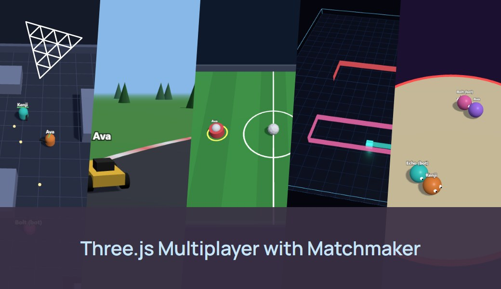
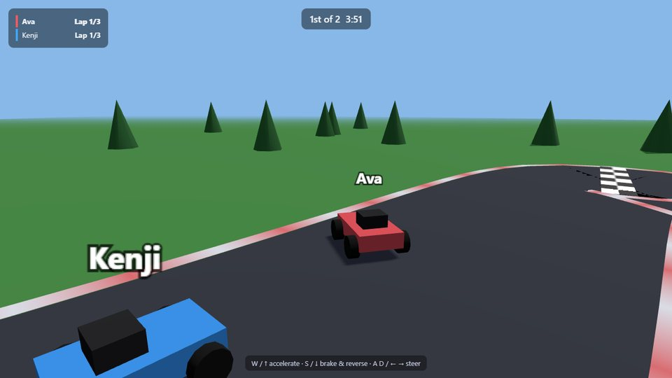
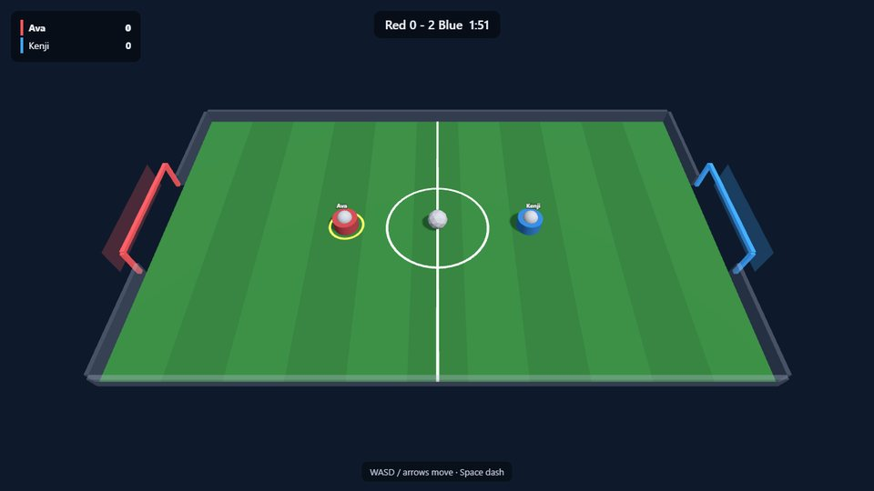
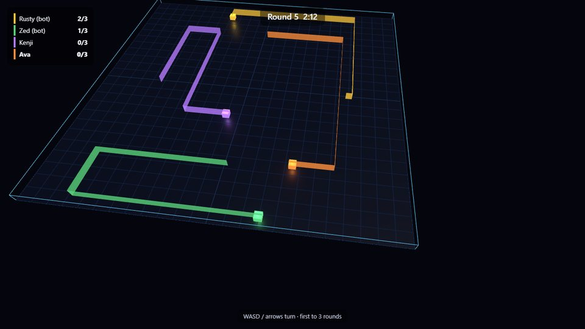
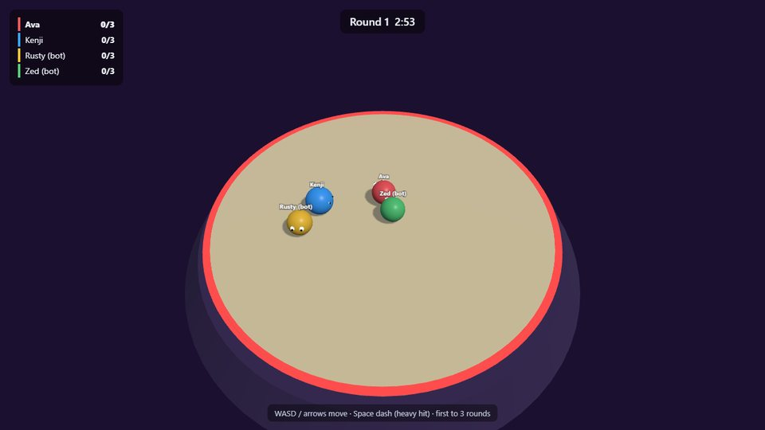

# Three.js Multiplayer with Matchmaker



Five browser multiplayer minigames built with [Three.js](https://threejs.org) and plain Node.js WebSocket servers. Players click **Find match**, the [Edgegap matchmaker](https://docs.edgegap.com/learn/matchmaking) groups them and starts a dedicated server near them, and everyone plays on that **authoritative server**. When the match ends, the server stops itself, and billing stops with it.

| | Game | Genre | Players | Matchmaker profile |
|---|---|---|---|---|
|  | [**Blaster Arena**](games/blaster) | Top-down shooter: first to 10 kills | 2–8, bots fill to 3 | `blaster` |
|  | [**Kart Rally**](games/kart) | Racing: 3 laps, grass is slow | 1–8 | `kart` |
|  | [**Rocket Soccer**](games/soccer) | Sports: 1v1 or 2v2, **teams from the matchmaker** | 2–4 | `soccer` (2 teams) |
|  | [**Light Cycles**](games/cycles) | Arcade: last one riding wins the round | 2–6, bots fill to 4 | `cycles` |
|  | [**Sumo Push**](games/sumo) | Party: shove everyone off a shrinking ring | 2–8, bots fill to 4 | `sumo` |

What this sample shows:
- **Matchmaking from the browser**: ticket, polling, cancel, rate-limit backoff, and one matchmaker with a profile per game, including a 2-team profile.
- **Authoritative servers**: the browser only sends inputs (keys, aim) and draws the state, so players can't change the rules in devtools.
- **One server per match on Edgegap**: placed near the players, reached over `wss://` with TLS Upgrade, and stopped by itself when the match ends, when everyone leaves, or when nobody shows up.
- **One image for five games**: an app version per game, picked with a `GAME` env var.
- **Tests**: headless players play full matches locally, in Docker, and end to end through the matchmaker on Edgegap.

Verified end to end on Edgegap on 2026-10-22, see [Tests](#tests).

```
browser ──POST /tickets {profile:"kart"}──▶ Edgegap Matchmaker ──deploys kart-v1 near the players──▶ Edgegap
browser ◀──HOST_ASSIGNED {fqdn, ports.gameport.external}──
browser ══wss://<id>.pr.edgegap.net:<port>══▶ Node.js game server (one per match) ──stops itself after the match
```

## Quick start (local, 2 minutes)

Needs Node.js 20 or newer.

```bash
npm install
npm run dev:all
```

This starts the five game servers (ports 7771–7775) and serves the pages at http://localhost:8080. Pick a game and click **Local server**, then open a second tab to play against yourself. Bots fill empty seats.

```bash
npm test
```

`npm test` plays a full match of every game with two headless players and checks the phases, the scoreboard and the result.

## Host it on Edgegap

You need an [Edgegap account](https://app.edgegap.com) and Docker.

### 1. Push the image

```bash
docker login registry.edgegap.com
docker build --platform linux/amd64 -t registry.edgegap.com/<project>/threejs-minigames:<tag> .
docker push registry.edgegap.com/<project>/threejs-minigames:<tag>
```

Use your Container Registry credentials and project from the dashboard (**Container Registry**). Tag with a date or commit, never `latest`.

### 2. Create the application and one version per game

In the dashboard (**Applications → Create**), or with the [Edgegap MCP server](https://github.com/edgegap/edgegap-mcp) from your coding agent, create the application `threejs-minigames` with five versions on the same image:

| Setting | Value |
|---|---|
| Version name | `blaster-v1`, `kart-v1`, `soccer-v1`, `cycles-v1`, `sumo-v1` |
| Image | `registry.edgegap.com/<project>/threejs-minigames:<tag>`, plus your registry username and token |
| Port | `7777`, protocol **WS**, name `gameport`, **TLS Upgrade on** (browsers need `wss://`) |
| Environment variable | `GAME` = `blaster` / `kart` / `soccer` / `cycles` / `sumo` |
| Resources | 0.25 vCPU / 512 MB |
| Max duration | 30 minutes (a safety net: servers stop themselves) |

Test one version with a direct deployment before adding the matchmaker:

```bash
EDGEGAP_API_TOKEN=<your API token> node edgegap/deploy.mjs threejs-minigames sumo-v1
```

It prints `wss://<id>.pr.edgegap.net:<port>`. Open `http://localhost:8080/games/sumo/?server=<that url>` in two tabs and play. The server stops itself after the match. Your API token controls your whole Edgegap organization: keep it on your machine or backend, never in the page or the image.

### 3. Create the matchmaker

**Matchmaker → Create Matchmaker**, upload [`edgegap/matchmaker-config.json`](edgegap/matchmaker-config.json), then **Create and Start**. It has one profile per game, each deploying that game's version:

- `blaster`, `kart`, `sumo` (2–8 players) and `cycles` (2–6): a single team. After 20 s, a lone player gets a server with bots.
- `soccer`: `team_count: 2`, 1–2 players per team, so 2v2 when four players are queued, else 1v1. The matchmaker gives each ticket a `team_id`, and the server puts each player on their team.
- `allowed_cors_origins`: the origins your pages are served from (`http://localhost:8080` and `https://edgegap.github.io` in the file). Add yours, exactly: scheme, host and port.

Copy the matchmaker's **API URL** and **Auth Token** into [`client/config.js`](client/config.js), or into a git-ignored `client/config.local.js` with the same shape, or add `?mm=<url>&token=<token>` to the page URL. The Auth Token is made to ship in game clients: it can only create and read tickets.

Now **Find match** works on every game page. Two tabs that click it within 20 s land on the same server.

### 4. Ship the pages

The pages are static files with no build step: `index.html`, `client/` and `games/`. Host them anywhere (GitHub Pages, itch.io, a CDN), and add that origin to `allowed_cors_origins`.

## Tests

| Command | What it checks |
|---|---|
| `npm test [game...]` | Each game server, locally, with short timers: two headless players go through every phase, see the same scoreboard and get a result. |
| `TEST_URL=ws://localhost:7777 npm test kart` | The same against a running container (`docker run -e GAME=kart -p 7777:7777 ...`). |
| `MM_URL=<url> MM_TOKEN=<token> npm run e2e [game...]` | The whole path on Edgegap: players queue through the matchmaker, all land on one deployment, play a full match, the server reports the matchmaker's tickets (and even teams for soccer), then the deployment stops itself. |

Results on 2026-10-22 (matchmaker 3.3.2):

| Game | Players | Matched in | Match | Deployment stopped |
|---|---|---|---|---|
| Blaster Arena | 3 | 15 s | first to 10 kills | 17 s after the match |
| Kart Rally | 2 | 14 s | 3 laps, ~35 s | 17 s after the match |
| Rocket Soccer | 4 (2v2, teams 0,0,1,1) | 6 s | 2 minutes | 17 s after the match |
| Light Cycles | 2 + 2 bots | 16 s | first to 3 rounds | 17 s after the match |
| Sumo Push | 3 + 1 bot | 14 s | first to 3 rounds | 17 s after the match |

A browser on `http://localhost:8080` also clicked **Find match** and played with a headless player on Edgegap. Matched deployments that nobody joined stopped themselves after 120 s.

## Documentation

- [How it works](docs/architecture.md): protocol, match phases, the Edgegap lifecycle, environment variables, the client, the matchmaker profiles.
- [Adding a game](docs/adding-a-game.md): the game interface, the client, wiring, testing and hosting.
- Each game's README: rules, controls, what the server decides, tuning.
- Edgegap docs: [deployments](https://docs.edgegap.com/learn/orchestration/deployments), [matchmaking](https://docs.edgegap.com/learn/matchmaking).
- Coding agents: the `edgegap-threejs` skill in [Edgegap's agent skills](https://github.com/edgegap/llm-agent-skills) ships this sample's server and client as templates.

## Repository layout

```
games/<game>/server.js     the game's rules (server only)
games/<game>/client.js     the game's Three.js rendering and input
games/<game>/index.html    the page (Three.js from a CDN through an import map)
games/<game>/README.md     rules, controls, server design, tuning
server/                    shared server: entry point, match room, Edgegap lifecycle, helpers
client/lib/                shared client: menu, HUD and stage (shell.js), matchmaker client, WebSocket helper
client/config.js           matchmaker URL and Auth Token
edgegap/                   matchmaker config, direct-deploy script
tools/                     local web/dev servers, local tests, end-to-end test, headless player
docs/                      architecture, adding a game, images
Dockerfile                 one image with every game server; GAME picks one
```

## Troubleshooting

| Symptom | Fix |
|---|---|
| **Find match** is greyed out | No matchmaker configured: set `client/config.js`, `client/config.local.js` or `?mm=&token=`. |
| CORS error in the browser console | Add the page's origin to `allowed_cors_origins` in the matchmaker config (scheme + host + port, no trailing slash). |
| Ticket calls fail with 401 | Wrong matchmaker Auth Token, or a `Bearer`/`token` prefix. Send it raw. |
| Stuck on "Searching for players" | Not enough players for the profile yet. A lone player gets a server after 20 s, except in soccer, which needs two. |
| "Match found" then back to searching, again and again | The deployment can't start: check that the version has registry credentials, and on the free tier stop leftover deployments (one at a time). |
| Connected after a few "Server starting" retries | Normal: a fresh deployment needs a few seconds before it accepts connections. |
| `ws://` blocked on an `https` page | Connect with the `wss://<fqdn>:<port>` from the matchmaker. TLS Upgrade must be on for the port. |
| Server waits 15 s before the countdown | A matched player never connected (closed tab). With everyone in, the countdown starts at once. |
| Test players split across servers | Old tickets from an interrupted run were still queued. Wait 30 seconds for them to expire, or restart the matchmaker. |
| Deployment didn't stop | Read its logs (dashboard or `edgegap_get_deployment_logs`) for `self-stop` lines. |

## License

MIT. Three.js (MIT) is loaded from jsDelivr.
