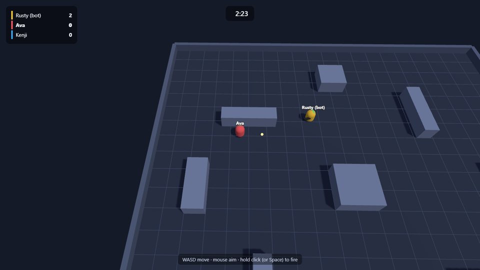

# Blaster Arena

Top-down free-for-all shooter. First to **10 kills** wins, or the most kills when the **2:30** timer runs out.

| | |
|---|---|
| Genre | Shooter |
| Players | 2–8 per match; bots fill up to 3 |
| Controls | WASD / arrows move · mouse aim · hold click or Space to fire |
| Matchmaker profile | `blaster` → app version `blaster-v1` |
| Local port | 7771 (`npm run dev:blaster`) |

## What the server decides

[`server.js`](server.js) owns everything that matters:
- movement at 8 m/s, pushed out of the boxes and walls;
- the firing rate, one shot per 0.22 s;
- bullet flight at 30 m/s, with two sub-steps per tick so a bullet can't skip past a player;
- hits: 25 damage, so 4 hits kill;
- kills, and respawns after 2 s at a spawn point clear of cover;
- the end of the match.

The client ([`client.js`](client.js)) sends only `{mx, mz, aim, fire}`: two movement axes clamped to [-1, 1], an aim angle from the mouse, and a fire button. It draws the arena from `welcome.info` (size and boxes) and eases players and bullets toward the 20 Hz snapshots. Your own aim is drawn instantly, but the server decides where the shot goes.

## Bots

With fewer than 3 combatants the server adds bots. They close in to about 9 m, strafe around their target, and fire when it's within 16 m, with a little aim error.

## Tuning

Constants at the top of `server.js`: `SPEED`, `BULLET_SPEED`, `FIRE_COOLDOWN`, `DAMAGE`, `RESPAWN`, `KILLS_TO_WIN` and `OBSTACLES`. `config.matchSeconds` (150) is the time limit; `MATCH_SECONDS` on the app version overrides it.
